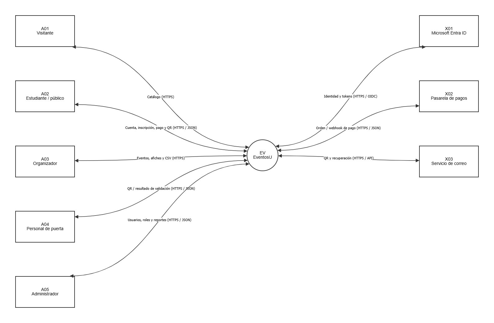
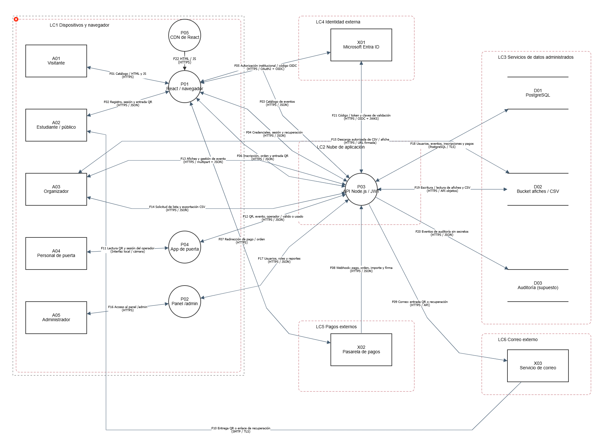

# EventosU - Modelado de amenazas

## Integrantes
- Douglas Daniel Pérez Hernández
- Carlos Daniel Martínez García

## Alcance
Analizo el diseño de EventosU: React servido desde un CDN, API Node.js con JWT, PostgreSQL, bucket, app de puerta, panel /admin e integraciones con Microsoft Entra ID, pagos y correo. Incluyo registro, recuperación, inscripciones, pagos, entradas QR, afiches, exportaciones CSV y auditoría.

Quedan fuera los sistemas internos de proveedores, datos de tarjetas y controles físicos ajenos a la aplicación. Es un ejercicio de diseño: los controles y pruebas están propuestos, no implementados. Los supuestos completos se documentarán en el informe final.

## Estado de la entrega
Esta primera versión contiene el modelo y los diagramas. El informe y la tabla CSV están pendientes de revisión y publicación por Carlos desde su propia cuenta. El repositorio estará listo para entregar cuando se complete [la lista de pendientes](docs/PENDIENTES.md).

## Estructura
```text
eventosu-threat-model/
├── README.md
├── model/eventosu.json
└── docs/
    ├── dfd-nivel-0.png
    ├── dfd-nivel-1.png
    ├── captura-threat-dragon.png
    └── PENDIENTES.md
```

Archivos previstos para completar la entrega: `docs/informe.pdf` y `docs/amenazas.csv`.

## Cómo abrir el modelo
1. Abrir [OWASP Threat Dragon](https://www.threatdragon.com/) y elegir sesión local.
2. Elegir abrir/importar un modelo existente.
3. Pegar el contenido completo de `model/eventosu.json` y pulsar Importar. En escritorio también puede abrirse el archivo directamente.
4. Abrir los diagramas `Nivel 0 - Contexto` y `Nivel 1 - Componentes y límites`.
5. Seleccionar un elemento o flujo para consultar sus amenazas. Ajustar el zoom cuando sea necesario.

El modelo fue abierto en Threat Dragon 2.6.2 el 12 de noviembre de 2026. Incluye 24 amenazas (cuatro por categoría STRIDE), 22 flujos y seis zonas de confianza. `Open` indica un control pendiente; `Accepted` corresponde a la aceptación de I04 propuesta para el ejercicio. No se han ejecutado pruebas de una aplicación real.

## Diagramas
### Nivel 0


### Nivel 1


Abrir las imágenes originales y ampliarlas para leer los flujos.

## Referencias
- [OWASP Threat Dragon](https://www.threatdragon.com/)
- [OWASP ASVS 4.0.3: control de acceso](https://github.com/OWASP/ASVS/blob/v4.0.3/4.0/en/0x12-V4-Access-Control.md)
- [OWASP ASVS 4.0.3: lógica de negocio](https://github.com/OWASP/ASVS/blob/v4.0.3/4.0/en/0x19-V11-BusLogic.md)

La referencia ASVS se fija en 4.0.3 para conservar identificadores consistentes; no se presenta como la versión más reciente.
